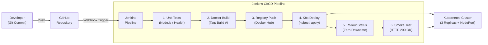

# Set 15: Complete CI/CD Pipeline (GitHub + Jenkins + Docker + Kubernetes)

## 1. Overview & Objective
This project implements **Set 15** of the Agile Development Process & DevOps lab:
> **"Implement a complete CI/CD pipeline using GitHub, Jenkins, Docker, and Kubernetes to build, test, and deploy a sample web application."**

This pipeline automates the entire software lifecycle from source code commit to a zero-downtime rolling update across a Kubernetes cluster.

---

## 2. End-to-End Architecture



---

## 3. Directory Layout

```
set-15-complete-cicd-pipeline/
├── Jenkinsfile              # Declarative CI/CD pipeline definition
├── Dockerfile               # Multi-stage production container image
├── README.md                # Comprehensive documentation & lab guide
├── app/
│   ├── package.json         # Node.js manifest & dependencies
│   ├── server.js            # Express web server with /health probe
│   └── test.js              # Automated unit & integration test suite
└── k8s/
    ├── deployment.yaml      # Kubernetes Deployment (3 replicas, rolling update)
    └── service.yaml         # Kubernetes NodePort Service (Port 30080 -> 3000)
```

---

## 4. Key Pipeline Stages

| Stage | Action | Description |
| :--- | :--- | :--- |
| **1. Checkout & Validate** | SCM / Git | Checks out code and prepares workspace metadata |
| **2. Automated Unit Tests** | `node app/test.js` | Executes test suite prior to packaging; blocks broken code |
| **3. Build Docker Image** | `docker build` | Builds image tagged with `${BUILD_NUMBER}` and `latest` |
| **4. Push to Registry** | `docker push` | Authenticates with Docker Hub and pushes immutable artifacts |
| **5. Deploy to Kubernetes** | `kubectl apply` | Applies Deployment & Service, updates image version dynamically |
| **6. Verify Rollout** | `kubectl rollout status` | Ensures all 3 replicas become healthy before declaring success |
| **7. Smoke Test** | `wget /health` | Sends active HTTP health check to running pods |

---

## 5. Setup & Configuration in Jenkins

### Step 1: Add Kubernetes Kubeconfig Credential
1. Navigate to: **Jenkins Dashboard** &rarr; **Manage Jenkins** &rarr; **Credentials** &rarr; **System** &rarr; **Global credentials**.
2. Click **Add Credentials**:
   - **Kind**: `Secret file`
   - **File**: Upload your `kubeconfig` (`~/.kube/config` or `C:\Users\<user>\.kube\config`)
   - **ID**: `k8s-kubeconfig`
   - **Description**: `Kubernetes Cluster Kubeconfig`
3. Click **Create**.

### Step 2: (Optional) Add Docker Hub Credentials
1. In **Global credentials**, click **Add Credentials**:
   - **Kind**: `Username with password`
   - **Username**: Your Docker Hub username
   - **Password**: Docker Hub Personal Access Token (PAT)
   - **ID**: `docker-hub-credentials`
2. Click **Create**.
*(Note: If running in a local Minikube/Docker Desktop environment where images are local, keep `PUSH_TO_REGISTRY=false`).*

### Step 3: Create Jenkins Pipeline Job
1. In Jenkins, click **New Item**.
2. Enter item name: `Set-15-Complete-CICD-Pipeline`.
3. Select **Pipeline** and click **OK**.
4. In the configuration:
   - Check **GitHub project** and paste your repository URL.
   - Under **Build Triggers**, select **GitHub hook trigger for GITScm polling**.
   - Under **Pipeline Definition**, select **Pipeline script from SCM** (or paste the `Jenkinsfile` directly).
   - Script Path: `sets/set-15-complete-cicd-pipeline/Jenkinsfile`.
5. Click **Save**.

---

## 6. Verification and Output Commands

Run these commands locally or via `kubectl` to verify the deployment:

```bash
# 1. Check all pods are running and ready (3/3 replicas)
kubectl get pods -l app=devops-sample-app -o wide

# 2. Check the service and assigned NodePort
kubectl get svc devops-sample-service

# 3. Test the application health check
curl http://localhost:30080/health

# 4. View deployment rollout history
kubectl rollout history deployment/devops-sample-app
```

Expected `/health` response:
```json
{
  "status": "UP",
  "timestamp": "2026-10-28T10:00:00.000Z",
  "version": "v1.0.0",
  "environment": "Production-K8s"
}
```

---

## 7. Agile & DevOps Principles Demonstrated
1. **Continuous Integration (CI)**: Fast automated tests validate code on every commit before building artifacts.
2. **Immutability & Packaging**: Docker packages application dependencies consistently across environments.
3. **Continuous Deployment (CD)**: Automated rolling deployment with zero downtime via Kubernetes RollingUpdate strategy (`maxSurge: 1`, `maxUnavailable: 0`).
4. **Resilience & Observability**: Native Liveness and Readiness probes enable Kubernetes to automatically restart unhealthy pods and route traffic only to ready containers.
